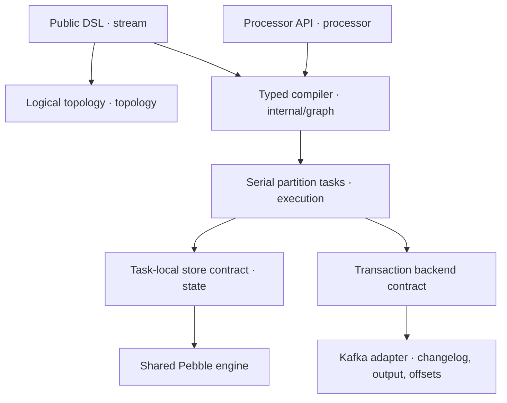
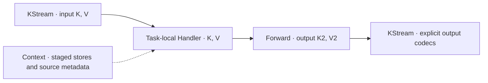
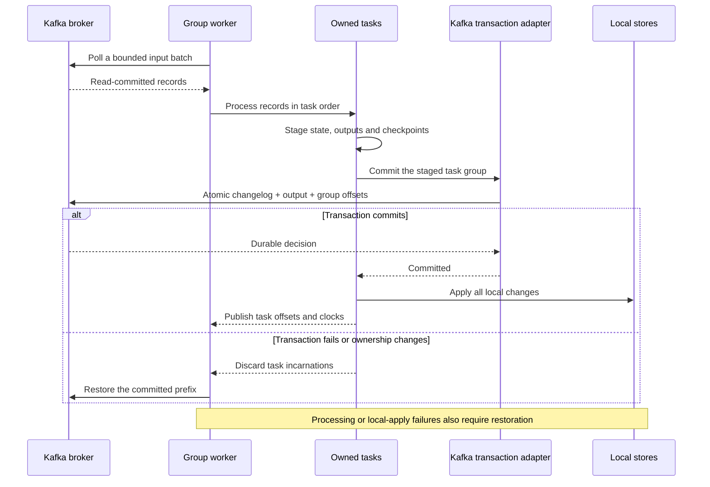
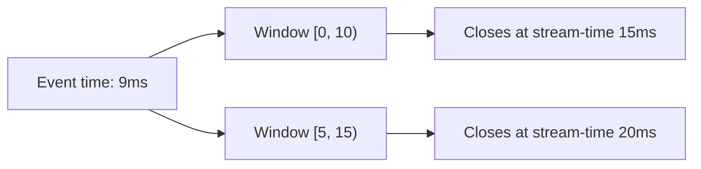

# kstream-go

An experimental, independent Go stream-processing core using Apache Kafka
Streams as its conceptual and semantic reference. Apache-2.0 licensed.

**This is an architecture and executable-core prototype, not a production Kafka
Streams replacement.** Experimental Kafka adapters support explicitly assigned
tasks and bounded consumer-group workers with atomic group-offset/state/output
transactions. Full group fault-tolerance qualification and distributed
repartitioning remain incomplete. An optional Pebble adapter
provides task-owned persistent caches on a shared engine. Kafka recovery replays
committed changes directly into the cache in bounded mutation batches; validated
local checkpoint reuse remains unimplemented.
The implemented oracle scenarios pass differential testing against Kafka
Streams 3.9.1; broader compatibility remains unproven. See the
[compatibility matrix](docs/compatibility.md) and [validation status](docs/validation.md).

The implementation keeps typed operators synchronous inside serial partition
tasks. It separates the public DSL, typed graph compiler, Processor API, logical plan, execution,
state and infrastructure adapters. No Java source or class hierarchy is ported.



Operators run as synchronous calls inside a task. Workers own tasks and stores;
the optional adapters supply broker transactions and persistent caches. See the
[architecture](docs/architecture.md) for package boundaries and current limits.

```go
b := stream.NewStreamsBuilder()
words := stream.Stream(b, "words", serde.String, serde.String)
counts := words.GroupByKey().Count("counts")
counts.ToStream().To("counts-out")
topology, err := b.Build()
```

Go does not support methods with additional type parameters. Type-changing
operations use package functions such as `stream.Map`, `stream.Process` and `stream.Join`;
type-preserving operations use methods. Null keys and values have explicit flags
in `record.Record[K,V]`; Go zero values are ordinary data. Source/sink/store
boundaries use explicit codecs. Build freezes the builder.

Custom processors also have typed input and output boundaries. A task creates
each supplier once; forwarding uses synchronous calls through the graph.
See the [Processor API](docs/processor-api.md) for source metadata and staged state.



Use [ordered branching](docs/stream-branching.md) to route each record to its
first matching stream; an explicit final predicate supplies a catch-all route.

For the experimental Kafka group worker, a successful batch follows this path:



## Run

Requires Go **1.27** or newer; the current toolchain baseline is **Go 1.27.3**.
The core uses only the standard library; optional Kafka and persistent-state
adapters use franz-go and Pebble respectively.

```sh
go run ./examples/wordcount
./scripts/validate.sh
```

The complete example instantiates an in-memory transaction backend, creates a
partition task, feeds records, and reads output. It prints `go: 1`, `kafka: 1`,
`go: 2` after the topology description. The [Kafka count example](examples/kafka-count/main.go) demonstrates the
experimental fixed-assignment adapter; see its [deployment boundaries](adapters/kafka/README.md).

## Included behavior

- `KStream`: filter/filterNot, map/mapValues, flatMap/flatMapValues, selectKey,
  merge, observers, typed custom processors with source metadata and sinks.
  See the [Processor API](docs/processor-api.md).
- `KTable`: source upserts, tombstone deletes, filter/filterNot, nullable value
  mapping, grouped counts and stream-triggered
  inner/left joins against current table state, including nullable results. See
  [table transforms](docs/table-transforms.md) and [stream-table joins](docs/stream-table-joins.md).
- `KGroupedStream`: `GroupByKey`, count, reduce, and type-changing aggregate with
  explicit nullable initialization/results and aggregate timestamps. See
  [grouped aggregation](docs/grouped-aggregation.md).
- Event-time tumbling and hopping counts with half-open windows, grace, aggregate timestamps,
  operator-local stream-time, and retention of open windows. See
  [time windows](docs/time-windows.md).
- Partition tasks with independent state, committed changelog recovery, offset
  replay suppression and generation fencing in the reference backend. The
  experimental Kafka adapter adds read-committed changelog restoration, broker
  producer fencing and atomic output/state/input-position checkpoints.
- Atomic state/output/offset transaction contract and fail-closed recovery after
  errors or ambiguous commit outcomes. External callback effects are outside it.
- Optional persistent state via a shared Pebble engine with isolated task
  namespaces, explicit sync durability, owned buffers and atomic local batches.
  Store errors abort processing; local apply failure after backend commit requires
  restoration. See [storage setup](adapters/pebble/README.md) and
  [design and limits](docs/adr/0007-persistent-state.md).
- Bounded-worker and goroutine-per-task finite-batch schedulers and comparative
  benchmarks. No production winner is asserted before measurement.
- Optional [atomic task groups](docs/task-groups.md) stage several partition tasks
  before one durable decision. The memory model and experimental
  [Kafka group worker](adapters/kafka/GROUPS.md) use this boundary.

Hopping windows let one event contribute to several counts. For size 10ms,
advance 5ms and grace 5ms, an event at 9ms belongs to both windows below:



If that event arrives at stream-time 15ms, it updates only the second window.

Key-changing maps/processors require repartitioning before key-local operations.
An explicit `Repartition` node is represented logically, and Build rejects it
until a broker adapter can implement an actual exchange. This avoids silently
producing incorrect distributed aggregates. Callbacks must be deterministic,
respect record immutability, and use task stores for recoverable state.

## Qualification program

Full Kafka Streams parity and a 2.5x production-throughput target are tracked in
[the feature inventory](docs/roadmap/parity.md), [qualification rules](docs/roadmap/qualification.md)
and [issue #3](https://github.com/SoraDaibu/kstream-go/issues/3). These targets are
not achieved by the initial prototype. Exploratory comparisons and all remaining
gaps remain visible. Package-layer rules are checked automatically in CI.

## Design and validation

Read the [architecture](docs/architecture.md) and the required ADRs:

1. [Kafka Streams compatibility boundaries](docs/adr/0001-compatibility.md)
2. [Public Go API and generics](docs/adr/0002-go-api.md)
3. [Task scheduling and concurrency](docs/adr/0003-scheduling.md)
4. [State durability and transaction coordination](docs/adr/0004-durability.md)
5. [Topology compilation and optimization](docs/adr/0005-compilation.md)

`go test -race ./...` exercises semantic boundaries and recovery. With Java 17,
Maven and Python 3 installed, `./scripts/differential.sh` compares exact output
traces against Kafka Streams **3.9.1** using its public TopologyTestDriver. See
[integration details](integration/README.md). The differential suite is a
correctness gate, not evidence of broker-level exactly-once behavior.

See [benchmark methodology](docs/benchmarks/README.md) for comparing schedulers.
The architecture remains provisional for production until independent semantics,
representative performance and broker failure gates pass.

Contributions follow [CONTRIBUTING.md](CONTRIBUTING.md). Apache Kafka and Kafka
Streams are ASF trademarks; this project is independent of the ASF.
