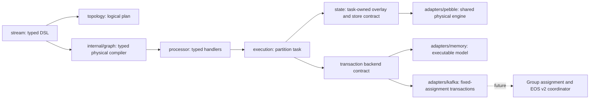

# Architecture

Read the [five ADRs](adr/0001-compatibility.md) before extending the runtime.
This is an experimental vertical slice, with explicit production release gates.

The DSL builds typed ports and logical metadata. Build freezes the plan; NewTask
compiles fresh closures and restores committed stores. Task.Process/ProcessBatch decode an
input once and calls operators synchronously. Output is serialized at the sink.
No goroutine or channel exists per operator. Batches run on explicitly bounded
workers or the benchmark comparison strategy. Only a task's current owner touches
its stores. Backend synchronization protects shared infrastructure, not operators.
The optional Pebble adapter gives each task an exclusive namespace in a shared
physical engine. The execution package depends only on the state.Store contract;
the composition root supplies an execution.WithStoreFactory option. Store I/O
errors are explicit, and a failed local apply after a backend commit invalidates
the task until committed state is restored. See [ADR 0007](adr/0007-persistent-state.md).

A caller-bounded record batch stages all mutations. Reads observe preceding
records in the batch; clocks advance per record. Repeated writes to a store key
coalesce inside the transaction while all output updates retain their order.
A small write set uses linear lookup, promoting to an index for larger batches. Successful backend commit precedes
publishing the local overlay. Failure invalidates the incarnation; recovery opens
a fenced generation and replays committed changelogs/offsets. The prototype uses
one input partition number per task, with any number of copartitioned topics.
Task IDs and application IDs are stable caller-provided infrastructure identities.

## Roadmap and acceptance gates

1. Core: typed stateless operators, tables, counts, stream-table joins, tumbling
   event-time counts, task isolation, transaction model, scheduling benchmarks.
2. Differential oracle: run deterministic and generated traces against Kafka
   Streams 3.9.1; capture and review every divergence. The harness is independent
   of Kafka's internal architecture and needs no Kafka broker.
3. Kafka adapter: read-committed fetch, group assignment, fenced transactions,
   changelogs, explicit broker repartition subtopologies and crash injection.
4. Persistent stores: write batches, checkpoints, compacted restore and retention.
5. Additional joins/windows, live scheduler fairness/latency benchmarks, then
   compatibility claims with a declared version and tested feature matrix.

Until stages 2–4 pass, do not use this as a production Kafka Streams replacement.

## Enforced package boundaries

`architecture/layers.json` declares allowed immediate package dependencies.
`scripts/check-layers.py` checks the actual Go import graph in CI. Infrastructure
libraries belong behind adapters; the DSL, runtime and state layers cannot import
adapters. Examples and commands are composition roots. Changing these boundaries
requires an explicit design decision and a corresponding rule update.

The [parity inventory](roadmap/parity.md) and [qualification target](roadmap/qualification.md)
track the remaining feature and performance program. Existing tests are evidence
for their covered cases, not a complete compatibility certification.
