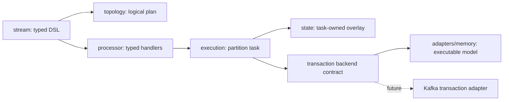

# Architecture

Read the [five ADRs](adr/0001-compatibility.md) before extending the runtime.
This is an experimental vertical slice, with explicit production release gates.

The DSL builds typed ports and logical metadata. Build freezes the plan; NewTask
compiles fresh closures and restores committed stores. Task.Process decodes an
input once and calls operators synchronously. Output is serialized at the sink.
No goroutine or channel exists per operator. Batches run on explicitly bounded
workers or the benchmark comparison strategy. Only a task's current owner touches
its stores. Backend synchronization protects shared infrastructure, not operators.

A record transaction stages all mutations. Successful backend commit precedes
publishing the local overlay. Failure invalidates the incarnation; recovery opens
a fenced generation and replays committed changelogs/offsets. The prototype uses
one input partition number per task, with any number of copartitioned topics.
Task IDs and application IDs are stable caller-provided infrastructure identities.

## Roadmap and acceptance gates

1. Core: typed stateless operators, tables, counts, stream-table joins, tumbling
   event-time counts, task isolation, transaction model, scheduling benchmarks.
2. Differential oracle: run deterministic and generated traces against Kafka
   Streams 3.9.1; capture and review every divergence. The harness is independent
   of Kafka's internal architecture and needs no Kafka broker.
3. Kafka adapter: read-committed fetch, group assignment, fenced transactions,
   changelogs, explicit broker repartition subtopologies and crash injection.
4. Persistent stores: write batches, checkpoints, compacted restore and retention.
5. Additional joins/windows, live scheduler fairness/latency benchmarks, then
   compatibility claims with a declared version and tested feature matrix.

Until stages 2–4 pass, do not use this as a production Kafka Streams replacement.
