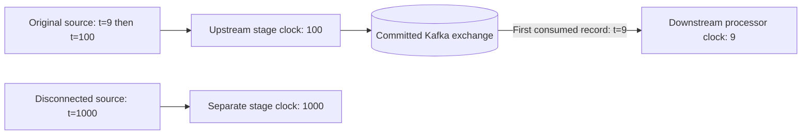

# Processing clocks

Custom Processor Context.StreamTime returns the maximum accepted source
timestamp in its connected stage, or -1 before that stage has consumed input.
All merged source streams and table lookup dependencies share a stage clock.
Disconnected sources and broker repartition boundaries have separate clocks,
even when they run in the same Go task and bounded worker.

Source acceptance advances the stage before decoding, filtering or forwarding.
A filtered input can advance its connected stage; a replayed offset cannot.
Changing a forwarded record's timestamp does not change that source clock. After
a broker exchange, its timestamp becomes the newly consumed source timestamp.
Window operators still use their own admitted-input clock and late-record rules.

Clock updates are staged with offsets, state and outputs, and become visible as
committed progress only after the backend transaction succeeds. Callback failures
discard the staged map. Ambiguous commits poison the task and require restore.
Recovery installs committed clocks before factories run. Sources in the same
batch observe their ordered accepted prefix, rather than the final batch clock.
The lower-level execution.Task.StreamTime remains the native partition-wide
clock; execution.ScopedContext is available when composing lower-level graphs.

At build time the compiler finds connected components, cutting only incoming
broker edges at repartition sources. A scope ID length-prefixes the sorted logical
source-name bytes, then encodes them as URL-safe base64 with a v1 prefix. Names must remain stable across restarts;
topology migration is not supported by this experimental version. Only stages
with custom processors need clock metadata. A single connected topology uses
the native clock directly, with no clock map or source observer.

Backends must atomically persist Transaction.ScopeTimes, a complete map alongside
the native StreamTime. Nil preserves previously committed scope clocks. Both
Open and OpenInto return owned ScopeTimes maps in their snapshot/checkpoint.
Kafka adds an optional scope_times field to complete changelog checkpoints; it
is omitted for ordinary topologies, preserving their existing JSON bytes.
The map is copied on its first advance in each transaction and never mutates a
committed map retained by a backend or recovery result.

Old checkpoints without scope clocks remain readable, but cannot reconstruct
the historical clock of individual stages. Start a new application ID and replay
when upgrading an existing multi-stage custom-processor application from the
shared-clock version. This is an explicit migration limit, not an inferred clock.

This does not implement cross-topic timestamp scheduling, max-task-idle controls,
punctuation or independent stage workers. Composed-driver Java oracle cases and Go broker recovery
tests validate the covered clock behavior; they do not establish full scheduling
equivalence. See [ADR 0027](adr/0027-processing-clocks.md).

The [Java oracle](../integration/README.md) pins the single-driver clock
coalescing limitation and uses separate public-API drivers for its two task
components. A live Java EOS v2 CI check independently verifies both task boundaries with
committed acknowledgments before late input. Broader Java/Go assignment, fault
and scheduling parity remains open.
