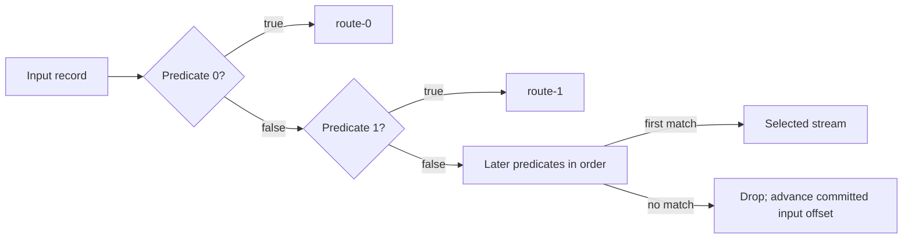

# Ordered stream branching

KStream.Branch returns a stream for each predicate. Predicates run in argument
order; only the first matching stream receives a record. This is the routing
behavior of Kafka Streams' branch/split operators. The Go API uses a single
method and an ordered slice rather than a Java builder and named result map.

```go
routes := events.Branch("route",
    func(r record.Record[string, string]) bool { return r.NullValue },
    func(r record.Record[string, string]) bool { return r.Value == "priority" },
    func(record.Record[string, string]) bool { return true },
)
routes[0].To("deletes")
routes[1].To("priority")
routes[2].To("other")
```



Null keys and values reach the predicates with their explicit null flags. Routing
preserves the complete record, including timestamp and key partitioning. A branch
may safely feed existing key-local grouping/join operations when its source is
already correctly partitioned. Predicates after a match are not evaluated.

Use a final always-true predicate to retain unmatched records. Otherwise they
produce no branch output, but their offsets still advance when the transaction
commits. A selected downstream error aborts the entire input transaction, including
state/output staged by other branches earlier in the batch. Existing poison and
restore rules apply. Predicate side effects are outside the transaction; use
pure predicates, especially when one topology creates several concurrent tasks.

Zero predicates and nil predicates are build errors. Logical output names are
the supplied name plus zero-based suffixes (`route-0`, `route-1`, ...); normal
topology name validation applies. The builder copies the predicate list, so the
caller may reuse its variadic slice. Captured callback state remains user-owned.

The router compiles to a single synchronous handler per task and calls typed
downstream handlers directly. Branches introduce no goroutines, channels,
record copies or asynchronous queues. Each record evaluates at most the number
of supplied predicates; a nonmatching or early matching record can do less work.
